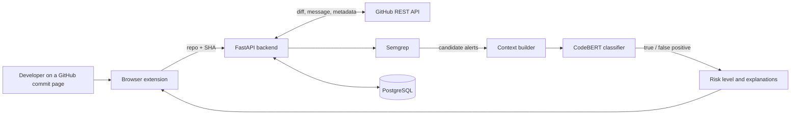

<div align="center">

# Commit Guard

**Context-aware false positive reduction for security analysis of Git commits**


</div>

**Bachelor Diploma Project (2026–2027)**

**Topic:** Development of an intelligent system for contextual analysis of Git commits to identify vulnerabilities and reduce false positives using machine learning methods

**Institution:** Astana IT University (AITU)
**Student group:** SE-2423
**Supervisor:** Tulebayev Yersultan Bakhytovich
**Milestone:** Pre-Defense 1 (October 2026)

---

##  Project Overview

Commit Guard is a browser extension for GitHub backed by a REST API. When a developer opens a commit or pull request page and clicks **Analyze**, the system checks the code changed by the commit and shows which security findings are likely to be real, instead of a long list of alerts to review one by one

The platform combines three ideas:

- **Static analysis as a source of candidates.** Semgrep scans the files changed by the commit and produces candidate alerts
- **Context-aware classification.** A CodeBERT-based classifier decides whether each alert is a true or a false positive, using the context of the change: the code diff, the surrounding code and the commit message
- **Feedback loop.** Users can mark a result as a false alarm; the feedback is stored for retraining



**Aim:** to reduce false positives of static analysis alerts while preserving vulnerability recall

##  Problem Statement, Target Users & Outcomes

### The Problem

- **Alert noise.** SAST tools produce many alerts that are not real problems. In our interviews with six practitioners, the respondents who gave estimates (4 of 6) considered only about 10–30% of automated alerts important
- **Time lost on triage.** Reviewing alerts takes 10–30 minutes per alert or 1–2 hours per week for the developer on duty
- **Weakened protection.** Because of the noise, teams raise severity thresholds, ignore notifications and disable rules, so real vulnerabilities can slip through
- **No change context.** Scanners look at code without the context of the change: what the commit modified and why (diff and commit message)

### Target Users

- **Software developers:** fast, accurate security feedback on their commits without noise
- **DevSecOps and cybersecurity specialists:** automated commit-level checks and less manual audit work
- **QA and code quality engineers:** a security check before code is merged into production branches

### Expected Outcomes

- A **browser extension** (Chrome / Edge) for on-demand analysis of GitHub commit and pull request pages
- A **context-aware ML pipeline** that filters Semgrep alerts using diffs and commit messages
- A **findings view** with the overall risk level (Low / Medium / High), highlighted lines, explanations and confidence scores
- A **backend REST API** (FastAPI) with PostgreSQL storage
- An **evaluation report** comparing the proposed system with baselines on precision, recall, F1, FPR, MCC, PR-AUC and latency

##  Team Members, Roles & Supervision

| Full Name | Student Group | Engineering Role | Responsibilities | GitHub Account |
|---|---|---|---|---|
| Aiymzhan Abilgazy | SE-2423 | Frontend Developer & Data Engineer | Data collection and preprocessing, database design, UI/UX and browser extension | @aiymzhanabilgazy |
| Aibar Tolegenov | SE-2423 | Machine Learning Engineer | False positive reduction model, training and evaluation, baselines and metrics | @oiibar |
| Marzhan Tulebayeva | SE-2423 | System Architect & Backend Engineer | System architecture, FastAPI backend, GitHub integration, system integration and testing | @Marzhan-b |

**Academic Supervisor:** Tulebayev Yersultan Bakhytovich, Astana IT University (AITU)

##  Scope Boundaries & Development Status

### Scope Boundaries

**In scope for the diploma MVP:**

- GitHub commit and pull request pages, analyzed on demand from the extension
- Fetching the commit diff and metadata through the GitHub REST API; private repositories with a user-provided token.
- Semgrep on the changed files; only alerts on lines changed by the commit are kept
- Context extraction: changed lines, surrounding code (tree-sitter), commit message
- Alert classification (true / false positive) with CodeBERT, compared with baselines B1–B3
- Risk level, highlighted findings with explanations, "False alarm" feedback stored in PostgreSQL
- Evaluation on the CVEfixes dataset with a project-based or time-based split

**Out of scope (future work):**

- Automatic scanning through webhooks or CI
- GitLab and Bitbucket support
- A team dashboard
- Dependency (SCA) alerts

### Pre-Defense 1 Components

| # | Component | Document | Status |
|---|---|---|---|
| 1 | Project proposal & scope | [`docs/project-proposal.md`](docs/project-proposal.md) | ✅ Done |
| 2 | Evidence of relevance (six practitioner interviews) | Presentation; summary in this README | 🟡 Separate document planned |
| 3 | Literature review (12 studies) | [`docs/literature-review.md`](docs/literature-review.md) | ✅ Done |
| 4 | Existing system comparison (5 systems, 8 criteria) | [`docs/existing-systems.md`](docs/existing-systems.md) | ✅ Done |
| 5 | Technology comparison (5 decisions) | [`docs/technology-comparison.md`](docs/technology-comparison.md) | ✅ Done |
| 6 | Requirements (10 FR with MoSCoW priorities, 7 NFR) | [`docs/requirements.md`](docs/requirements.md), [`docs/frontend-requirements.md`](docs/frontend-requirements.md) | ✅ Done |
| 7 | Architecture diagrams: component decomposition, use case, system context | [`diagrams/`](diagrams/) | ✅ Done |
| 8 | UX prototype: 11 screens and Figma | [`prototype/`](prototype/) | ✅ Done |
| 9 | Verification & evaluation plan | [`docs/evaluation-plan.md`](docs/evaluation-plan.md) | ✅ Done |
| 10 | Project management & risks | This README, YouTrack | ✅ Done |
| 11 | Supervisor feedback log | [`docs/supervisor-feedback.md`](docs/supervisor-feedback.md) | ✅ Done |

### Implementation Progress

| Component | Location | Status |
|---|---|---|
| GitHub client: commit diff and metadata | `src/backend/fetch_diff.py` | ✅ Done |
| Diff parser: line numbers added by a commit | `src/backend/diff_parser.py` | ✅ Done |
| Unit tests for the diff parser | `tests/test_diff_parser.py` | ✅ Done (3 tests) |
| FastAPI server with `/health` | `src/backend/main.py` | ✅ Done |
| ML data preparation and labeling (CVEfixes) | `src/ml/` | 🟡 In progress |
| `/analyze` endpoint, Semgrep runner, context extraction | `src/backend/` | ⬜ Planned |
| Baselines B1–B3 and CodeBERT classifier | `src/ml/` | ⬜ Planned |
| PostgreSQL storage and feedback saving | `src/backend/` | ⬜ Planned |
| Browser extension | `src/extension/` | ⬜ Planned (UX prototype ready) |

No evaluation results have been measured yet. All numbers in the requirements and the evaluation plan are targets

##  Evidence of Relevance (Summary)

We held informal, anonymous interviews with six practitioners (five software engineers and one support engineer). The sample is small and the figures are subjective estimates, because the teams do not keep statistics

- Of the respondents who gave estimates (4 of 6), only about 10–30% of automated alerts were considered important
- Triage takes 10–30 minutes per alert or 1–2 hours per week for the developer on duty
- Noise leads to relaxed settings: higher severity thresholds, ignored notifications, disabled rules
- Secrets leaked or almost leaked into repositories in several teams, often noticed by chance
- Code-level (SAST) evidence comes from R2 and R6 (R3 secondhand); dependency alerts (R1, R5) are out of scope of the current version

##  Requirements Summary

| ID | Requirement | Priority |
|---|---|---|
| FR-1 | Extension detects a GitHub commit or PR page and extracts the repository and SHA | Must |
| FR-2 | Extension sends an analysis request to the backend | Must |
| FR-3 | Backend fetches the commit diff and metadata via the GitHub REST API | Must |
| FR-4 | Context extraction: code changes, surrounding code, commit message | Must |
| FR-5 | Semgrep runs to obtain the initial alerts | Must |
| FR-6 | ML model classifies alerts as true or false positives | Must |
| FR-7 | Overall commit risk level (Low / Medium / High) | Must |
| FR-8 | Highlighted lines with explanation, confidence score and suggested fix | Should |
| FR-9 | User feedback (Correct / False alarm) saved for retraining | Should |
| FR-10 | Export of results (JSON / CSV) | Could |

Key non-functional targets: median latency ≤ 10 s and 95th percentile ≤ 30 s for commits up to 500 changed lines; HTTPS and no tokens in logs; at least 30% lower FPR than raw Semgrep with a recall drop of at most 5 percentage points; Chrome and Edge support; SUS ≥ 68; unit test coverage ≥ 60%; fixed seeds and Docker. Full list with acceptance criteria: [`docs/requirements.md`](docs/requirements.md)

##  Verification & Evaluation Plan (Summary)

- **Testing levels:** unit (parser, context extractor, risk scorer), integration (extension → API → GitHub API → Semgrep → ML model), end-to-end on real commit pages, usability with five users
- **Data:** CVEfixes, cleaned from duplicates and noisy labels
- **Labeling:** Semgrep runs on the code before the fix; alerts on lines changed by the fixing commit are true positives, the others false positives
- **Split:** by project or by time, not random, to prevent data leakage.
- **Systems compared:** B1 accepts all Semgrep alerts; B2 adds a simple rule (for example, ignore test files); B3 is XGBoost on hand-made features; the proposed system is Semgrep plus CodeBERT with commit context, run with and without context
- **Metrics:** precision, recall, F1, FPR, MCC, PR-AUC, latency

Details: [`docs/evaluation-plan.md`](docs/evaluation-plan.md)

## 🛠 Selected Technology Stack

| Layer | Technology |
|---|---|
| Browser extension | TypeScript, HTML/JS, Manifest V3 (Chrome, Edge) |
| Backend & API | Python 3, FastAPI, Uvicorn |
| Source data | GitHub REST API |
| Static analysis | Semgrep |
| Code parsing | tree-sitter |
| Machine learning | CodeBERT (fine-tuned), XGBoost baseline |
| Training data | CVEfixes |
| Database | PostgreSQL |
| Testing | pytest |
| Design | Figma |
| Project tracking | YouTrack, Git & GitHub |

The alternatives we considered and the reasons for each choice are in [`docs/technology-comparison.md`](docs/technology-comparison.md)

##  Project Management & Risks

### Timeline (September 2026 – May 2027)

| Stage | Period |
|---|---|
| Research and requirements | Sep – Oct 2026 |
| System design and UX | Oct 2026 |
| Data preparation | Nov – Dec 2026 |
| Backend and ML development | Oct 2026 – Feb 2027 |
| System integration | Feb – Mar 2027 |
| Testing and evaluation | Jan – Apr 2027 |
| Finalization | Apr – May 2027 |

Dependencies: data preparation starts after research and requirements; ML development needs a cleaned and labeled dataset; system integration depends on the backend, the extension and the ML components

### Risks

| Risk | Probability | Impact | Mitigation |
|---|---|---|---|
| Noisy or insufficient training data | High | High | Validate CVE-linked commits; review uncertain labels manually |
| High false positive rate | High | High | Compare Semgrep-only and ML-filtered results; tune decision thresholds |
| CodeBERT performance limitations | Medium | High | Limit input size, optimize inference, measure latency |
| Integration delays | Medium | Medium | Agree on API contracts early; integrate and test incrementally |

##  Repository Layout

```
commit-guard/
├── README.md                     # Project overview (this file)
├── config/                       # Configuration notes (.env template, Docker setup later)
├── diagrams/                     # Component decomposition, use case and system context diagrams
├── docs/
│   ├── project-proposal.md       # Aim, objectives, users, scope, expected outcomes
│   ├── literature-review.md      # 12 studies and their application to Commit Guard
│   ├── existing-systems.md       # Comparison of 5 existing systems on 8 criteria
│   ├── technology-comparison.md  # 5 technical decisions with alternatives
│   ├── requirements.md           # Functional (MoSCoW) and non-functional requirements
│   ├── frontend-requirements.md  # Requirements relevant to the extension
│   ├── evaluation-plan.md        # Testing levels, ML evaluation, metrics, baselines
│   └── supervisor-feedback.md    # Supervisor feedback and improvements
├── prototype/
│   ├── README.md                 # Screen descriptions and Figma link
│   └── designs/                  # 11 UI screens (PNG)
├── src/
│   ├── backend/                  # FastAPI app, GitHub client, diff parser
│   ├── extension/                # Browser extension (planned)
│   └── ml/                       # Data preparation, labeling, configs, metrics, notebooks
└── tests/                        # pytest unit tests
```

##  Project Tracking & External Links

- **GitHub repository:** https://github.com/oiibar/commit-guard
- **YouTrack board:** https://commit-guard.youtrack.cloud/projects/DIPLOMA (project key: `DIPLOMA`)
- **Figma prototype:** https://www.figma.com/design/VoR6uSJm0GcrpxgoARPnIx/Commit-Guard?node-id=0-1&t=CxOapwv2GMFGicDK-1

##  Local Setup & Testing Instructions

### 1. Prerequisites

- Python 3.10 or newer
- Git

### 2. Environment Setup

```bash
# Clone the repository
git clone https://github.com/oiibar/commit-guard.git
cd commit-guard

# Create and activate a virtual environment
python -m venv .venv

# On Linux / macOS:
source .venv/bin/activate
# On Windows (PowerShell):
.venv\Scripts\Activate.ps1

# Install backend dependencies
pip install -r src/backend/requirements.txt
```

### 3. Running Automated Tests

```bash
python -m pytest
```

Expected result: `3 passed`.

### 4. Fetching the Changes of a Commit

```bash
python src/backend/fetch_diff.py <owner> <repo> <sha>
# example:
python src/backend/fetch_diff.py oiibar commit-guard 610db04
```

The script prints the commit message, the changed files with their status and the patch of each file

### 5. Running the API Server

```bash
cd src/backend
uvicorn main:app --reload
```

Then open http://127.0.0.1:8000/health (expected response: `{"status": "ok"}`). Interactive API documentation is available at http://127.0.0.1:8000/docs

> Requests to the GitHub API without a token are limited to about 60 per hour. Never commit tokens or passwords: keep them in a local `.env` file, which is ignored by Git

Setup instructions for the ML part and the extension will be added when they are implemented

##  Git Workflow & Peer Review Policy

- Direct pushes to `main` are not allowed. Work is done in dedicated branches: `feat/...` for code, `docs/...` for documentation, `test/...` for tests.
- One YouTrack issue is one branch and one pull request.
- Every pull request needs an approval from another team member before merging.
- Commit and pull request titles follow the format `DIPLOMA-<id> <type>(<scope>): <summary>`, for example `DIPLOMA-33 feat(backend): parse added line numbers from patch`.
- A YouTrack issue is moved to Done only after its pull request is merged.

##  Limitations

- Commit Guard filters alerts produced by Semgrep. It does not search for new vulnerabilities on its own, so the recall of the system cannot exceed the recall of Semgrep.
- Labels derived automatically from CVEfixes are a heuristic and can be noisy; uncertain labels are reviewed manually.
- The prototype screens use Python code; the final list of supported languages will be fixed during implementation
- Findings are review hints, not a security verdict. A developer should check the code before making a decision

---

<div align="center">

Astana IT University · 2026

</div>