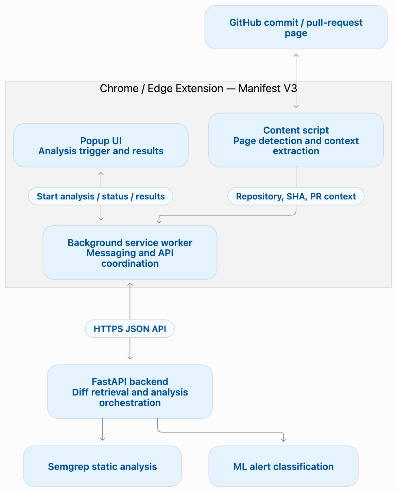
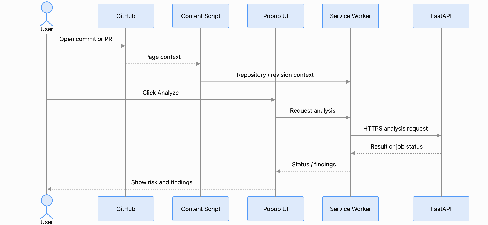

# Chrome Extension Architecture — Commit Guard
# 1. Purpose and Scope
This document describes the proposed architecture of the Commit Guard Chrome/Edge extension. The extension identifies supported GitHub commit or pull-request pages, lets users request an analysis, and presents security findings returned by the backend. Vulnerability scanning and ML classification are performed by backend services, not in the browser.

# 2. Architecture Overview

# 3. Component Responsibilities
|Component|Responsibility| Boundary|
|---|---|---|
|GitHub page|Displays the selected commit or pull request|External website; untrusted page content|
|Content script|Detect supported URLs, extract repository identity and commit SHA where available, observe navigation changes|No vulnerability analysis or secret handling|
|Popup UI|Offer Analyze action, show loading/errors, risk level and finding details|Presentation and user interactions|
|Background service worker|Validate messages, coordinate extension components, send API requests, handle failures|No ML inference or static analysis|
|FastAPI backend|Retrieve Git diffs and metadata, run analysis pipeline, return structured findings|Owned by backend/ML team|

# 4. Proposed User and Data Flow
1. The user opens a supported GitHub commit or pull-request page.
2. The content script detects the page type and extracts repository and revision context.
3. The popup shows the current context and enables the Analyze action when valid.
4. The user requests analysis. The popup sends a message to the background service worker.
5. The service worker validates the request and communicates with the FastAPI backend over HTTPS.
6. The backend retrieves the diff and metadata, runs Semgrep and the ML filtering pipeline, and returns a result or job status.
7. The extension displays the overall risk level and available findings, explanations, and statuses.
8. On failure, the extension shows a recoverable error and offers retry where appropriate.

# 5. Interface Contracts (Proposed)
Before writing the code, it is necessary to approve the final endpoint paths and data structure with the backend developer. Conceptually, the request can transmit the repository owner and name (repository_owner, repository_name), the commit hash (commit_sha), or the PR identifier (if pull request analysis is supported). The API response may include analysis_id, status, risk_level, and a list of found issues (findings) containing the location, criticality, description, and confidence level of the model.

# 6. Manifest V3 and Permissions
- Use Manifest V3 with a background service worker.
- Restrict content scripts to required GitHub URL patterns; validate repository and revision identifiers.
- Prefer the least-privilege permission set. Candidate permissions may include activeTab, scripting, and/or storage only if implementation needs them.
- Limit host_permissions to the required GitHub pages and the approved backend origin; avoid <all_urls>.
- Define a Content Security Policy compatible with extension restrictions; do not execute remote scripts.
- Do not embed API tokens or other secrets in client-side source code.
The final manifest.json permissions will be determined during implementation and security review.

# 7. Security and Error Handling
- Treat GitHub page text, commit messages, and backend responses as untrusted data; render as text rather than injecting raw HTML.
- Use HTTPS for backend requests outside local development.
- Validate extension messages and API payloads; avoid leaking repository data or credentials in logs.
- Handle unsupported GitHub URLs, missing SHA, rate limits, network failures, timeouts, and unavailable backend services.
- Do not store raw diffs or sensitive analysis content persistently unless there is a documented requirement and retention policy.
- A false-positive filter must not silently hide potentially critical findings without an agreed UX and evaluation policy.

# 8. Requirement Traceability
|System requirement|Extension architecture responsibility|
|---|---|
|FR-1|Content script detects supported GitHub commit/PR pages and extracts repository/revision context|
|FR-2|Popup and service worker initiate a request to the backend|
|FR-7|Popup presents overall risk level supplied by the backend|
|FR-8|UI presents finding locations, explanations and available confidence/fix guidance|
|FR-9|Optional feedback UI and submission flow; backend persistence is a dependency|
|FR-10|Optional JSON/CSV export initiated from the UI|
|FR-3–FR-6|Backend and ML dependencies; not extension-owned|

Priorities and acceptance criteria remain defined in the system-level requirements document. FR-8 and FR-9 are Should, and FR-10 is Could, so they are not all mandatory MVP deliverables.

# 9. Verification Plan
|Check|Proposed verification|
|----|----|
|GitHub URL detection|Test at least 10 supported commit URLs as required by FR-1; separately test PR pages|
|Message passing|Confirm context and analysis actions reach the intended extension components|
|API communication|Use a mock API, then the integrated FastAPI service, including error cases|
|Results rendering|Verify risk levels and findings against known mock responses|
|Compatibility|Test current Chrome and Edge versions|
|Security|Review permissions, HTTPS, secret handling, and unsafe HTML rendering|
|Recovery|Test unsupported URLs, malformed payloads, network failures, and backend timeouts|

10. Open Design Decisions
- Does the MVP analyze a single commit, a whole PR, or both?
- Will the popup own the full findings view, or will an extension side panel be used?
- Is analysis synchronous, or does the backend return a job ID for polling?
- Which authentication model and backend deployment origin will be used?
- What exact finding fields and confidence indicators will the backend return?

These decisions should be confirmed with the backend engineer and the UX prototype before frontend implementation.